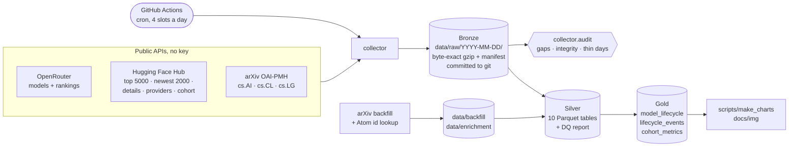
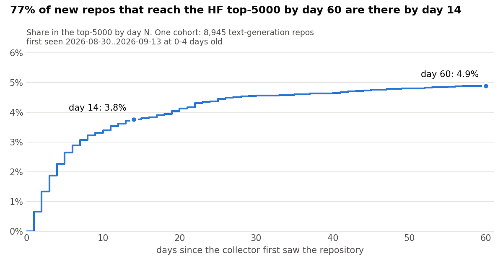
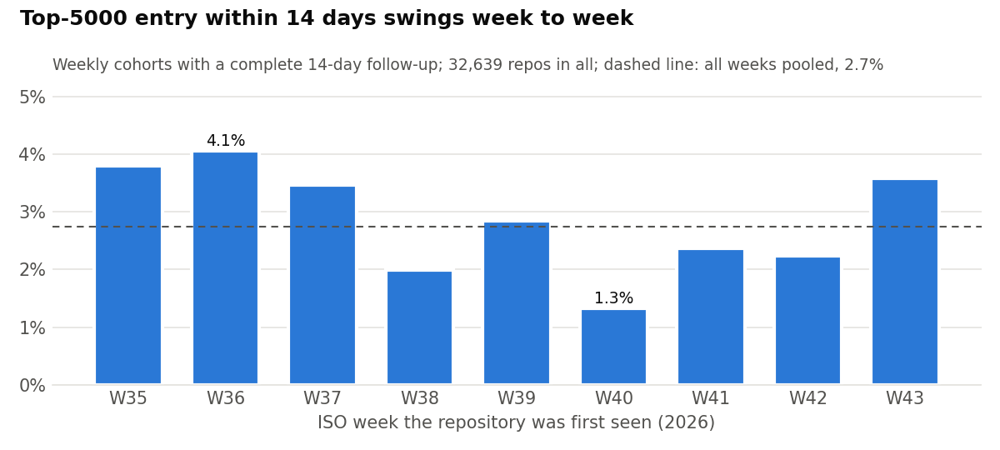

# Open Model Lifecycle

**How fast does a newly released open model get picked up - and does it at all?**
Every day a few hundred text-generation repositories appear on Hugging Face.
This project follows each one from the day it is first seen and asks whether it
breaks into the 5,000 most-downloaded within days, weeks or never, and whether
it reaches a hosted API (OpenRouter). It is a **daily, unrepeatable series**:
Hugging Face exposes only a rolling 30-day download count and OpenRouter
publishes no usage history, so the curve exists only because a collector has
snapshotted both every day since **2026-08-28**. A missed day cannot be
re-collected. arXiv metadata is joined in to see which repositories cite a paper.

## Architecture



Bronze is the system of record and is never rewritten; Silver and Gold are
gitignored and rebuilt from it by full replay (`python -m silver && python -m gold`).

## Findings

Gold rebuilt on **2026-11-13** from 78 daily snapshots (2026-08-28..2026-11-13).
The cohort is every text-generation repository the collector first saw in the
2,000-newest list at 0-4 days old: **42,702 repositories**, first seen
2026-08-30..2026-11-13. A repository counts at horizon N only once it has been
followed for N days. Numbers come from `data/gold/` and
[`docs/img/charts.json`](docs/img/charts.json); exact definitions are in the
[Gold metric contract](docs/gold_metric_contract.md).

1. **2.8% break into the top-5000 within 14 days** - 980 of 34,875 repositories
   with 14 days of follow-up. The rest never appear in the 5,000 most
   downloaded during that window.
2. **It happens early or not at all.** In the oldest cohort that has 60 days of
   follow-up (8,945 repositories), 3.8% are in by day 14 and 4.9% by day 60:
   77% of everything that gets there in two months gets there in two weeks.
3. **The rate is not stable week to week.** Fully followed weekly cohorts range
   from **1.3% (W40) to 4.1% (W36)** at 14 days. A single headline rate hides
   that; any model of it has to allow for it.
4. **Early likes separate, an arXiv citation does not.** Among the 34,875: a
   repository with any like when first seen reaches the top-5000 in 14 days
   **12.7%** of the time (502 of 3,955), one with none **1.5%** (478 of 30,920).
   One that cites an arXiv paper does *worse*: **1.1%** (93 of 8,741) against
   3.4%. Associations in a selected sample, not causes - but "has a paper" is
   no shortcut to uptake.

<picture>
  <source media="(prefers-color-scheme: dark)" srcset="docs/img/top5000_entry_curve-dark.png">
  
</picture>

<picture>
  <source media="(prefers-color-scheme: dark)" srcset="docs/img/top5000_entry_by_week-dark.png">
  
</picture>

**Joining to a hosted API is the hard part.** On the 2026-11-13 snapshot,
**192 of 475 OpenRouter models (40%)** declare a non-empty `hugging_face_id`
(180 of 398, 45%, on 2026-08-29). The field is present on every model and
empty on the rest, so testing for presence instead of a value would claim 100%.
Only those 40% join by key; the others would need fuzzy matching, which is kept
out of Gold. Earlier, narrower write-ups: [Silver](docs/findings/silver.md),
[Gold on 34 days](docs/findings/gold.md),
[provider expansion](docs/findings/provider-expansion.md).

## Running it

```bash
pip install -r requirements-dev.txt
python -m collector              # today's Bronze snapshot (UTC); idempotent
python -m collector.audit        # Bronze integrity, gaps and coverage
python -m collector.arxiv_ids    # cached exact-ID arXiv lookups; safe to rerun
python -m silver                 # full replay: Bronze -> Silver Parquet + DQ report
python -m gold                   # deterministic lifecycle and cohort rebuild
python -m scripts.make_charts    # README charts and charts.json from Gold
pytest -q && ruff check .
```

The collector runs itself in GitHub Actions (`.github/workflows/collect.yml`);
the local commands are for rebuilding the analysis from the committed snapshots.
A full Silver + Gold replay of 78 days took 2 min 45 s on a laptop
(2026-11-13).

## Data layout

| Layer | Where | In git | Grain |
|---|---|---|---|
| Bronze | `data/raw/<YYYY-MM-DD>/` | yes | one directory per UTC day: one gzip per source leg plus `_manifest.json` with URL, status, byte counts and SHA-256 of the bytes as received |
| Backfill / enrichment | `data/backfill/arxiv/`, `data/enrichment/` | yes | retrospective arXiv harvests and Atom lookups, kept apart from daily observations |
| Silver | `data/silver/*.parquet` | no | `hf_observations` (repo × day × leg), `hf_repositories` (repo × day), `openrouter_models`, `arxiv_papers`, `model_platform_links`, `hf_arxiv_links`, provider observations, `dq_report.json` |
| Gold | `data/gold/` | no | `model_lifecycle` (one HF repository), `lifecycle_events` (repo × event), `cohort_metrics` (first-seen week × horizon), `summary.json` |

Every Bronze leg, the reasons for the list sizes (why top 5,000 and newest
2,000), the storage format and the audit checks are documented in
[docs/collector.md](docs/collector.md).

## Operational rules

- **Bronze is not reformed.** Payloads are stored byte for byte; loaders cast
  and rename and never filter, aggregate or join. Silver and Gold are rebuilt by
  replay. `tests/test_bronze_is_verbatim.py`.
- **Idempotent by day key, proven by a double run.** A second run of a complete
  day makes zero HTTP calls and changes zero bytes. `tests/test_idempotence.py`.
- **Absence is not zero.** A 401/404 repository produces a manifest entry, not
  a row with zero downloads.
- **The audit must stay readable.** `python -m collector.audit` runs after every
  collection. A permanent loss is admitted, with a reason, in
  [`known_gaps.txt`](known_gaps.txt) (a missing day) or
  [`known_incomplete.txt`](known_incomplete.txt) (a day with one unfinished
  leg), so the alert returns to green and still catches the next real gap.
  Current state (2026-11-13): 78 days, no missing day, one acknowledged leg -
  arXiv on 2026-11-08, re-harvested from the backfill.
- **Every cross-source join publishes its coverage** - see the OpenRouter ↔ HF
  figure above and `data/silver/dq_report.json`.
- **Polite crawling.** Identifying User-Agent, a floor between requests,
  bounded retries, `Retry-After` honoured.

Storage decision and its revisit date: [ADR 0001](docs/adr/0001-snapshots-live-in-git-until-s3.md).

## Limitations

- **The top-5000 is a proxy, not production.** It measures Hugging Face
  downloads, a rolling 30-day count of download requests, automated ones
  included. It says nothing about who serves the model in production.
- **Selected samples.** Only text-generation repositories in the 2,000-newest
  and 5,000-top lists are seen. Rates are relative to that sample, not to all
  of Hugging Face.
- **Repositories, not models.** Quantisations and re-uploads of the same weights
  are separate repositories; adoption of one base model is spread across them.
- **OpenRouter is sparse here.** 6 of the 42,702 cohort repositories have
  appeared on OpenRouter so far (2026-11-13), too few for a diffusion rate.
- **arXiv tags are citations, not identity.** An `arxiv:` tag means the model
  card references a paper, not that the paper describes this model.
- **One open data-quality error.** The 2026-11-13 Gold build reports one row
  with a negative `days_to_openrouter` (`nex-agi/Nex-N2.6`): the OpenRouter
  listing was seen before the HF repository. Under investigation.
- **Follow-up is short.** The oldest cohort has about 75 days; 90-day horizons
  are not yet eligible.
