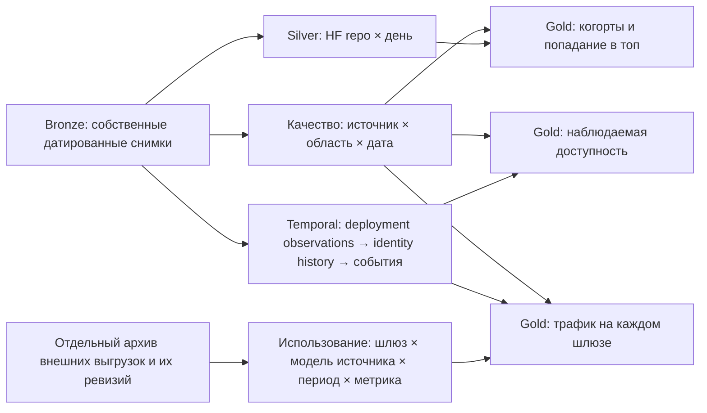

# Open Model Lifecycle: следующий аналитический слой

Обзор на 15 ноября 2026 года. Это предложение, не изменение логики сбора. Цель: отвечать на три разных вопроса об открытой текстовой модели: когда её заметили на HF, кто предложил её через API и когда появился измеримый трафик на конкретном шлюзе. У каждого ответа своя единица наблюдения и свой знаменатель.

## Что показывают собственные данные

| Проверка | Результат и практическое следствие |
|---|---|
| Состояние архива | `python -m collector.audit`: 79 дат, 28.08–14.11, 0 ошибок, 1 признанное предупреждение arXiv 08.11. Сохранённый [Gold](../../gold/build.py) заканчивается 13.11; проверенный [Temporal](../temporal_lifecycle_events.md) — 02.10. Выводить дату каждого входа, не выдавать всё за текущий день. |
| Популярность репозиториев | По [Gold v1](../gold_metric_contract.md) 980 из 34 875 подходящих репозиториев вошли в топ-5000 к дню 14 (2,81%); основная когорта — 42 702 репозитория. Сохранить этот показатель как воспроизводимый ориентир, показывать также устойчивость (три наблюдения в топе), числитель, знаменатель и дату среза. |
| Доступность у провайдеров | При точном сопоставлении с основной когортой до 13.11 включительно 19 репозиториев хотя бы однажды имели HF-связь со статусом `live`, 6 наблюдались в OpenRouter, 4 попали в обе группы: всего **21** уникальный репозиторий. Старт HF-провайдеров — 01.10; это наблюдённое пересечение, а не вероятность получить API. Семейства моделей здесь не объединены. |
| Разнообразие хостов | Во всех 45 HF-снимках 01.10–14.11 одни и те же 14 имён провайдеров. На 14.11: 6 425 репозиториев, 6 541 запись о соответствии; 6 371 запись Featherless, 6 501 запись всех хостов со статусом `live`. У 42 репозиториев два или больше различных `live`-хостов, у семи — пустой массив соответствий. Это ширина конкретного каталога, а не рыночная доля или проверка работающего API. |
| Полнота идентификации | В [снимке 14.11](../../data/raw/2026-11-14/_manifest.json) 191 из 471 маршрута OpenRouter объявляет непустой HF ID, всего 169 различных ID. Публиковать долю связанных строк **и** долю атрибутируемого трафика: совпадение 40% каталога само по себе ничего не говорит о покрытии токенов. |
| Потеря наблюдаемости | В [фиксированной панели](../hf_cohort_architecture_freeze.md) из 1 500 репозиториев успешно измерены 1 455 на 16.10 и 1 381 на 14.11. На последнюю дату 864 измерения получены только благодаря панели; у 73 ответов ID отличается от запрошенного, ещё 46 — HTTP-ошибки. Показывать причины и покрытие отдельно для popular/recent/remaining. Замены ID проверять с историей; отказ доступа не считать исчезновением. |

Если выровнять окна, редкость становится ещё заметнее. Среди 16 550 репозиториев основной когорты, впервые увиденных не раньше 01.10 и подходящих по правилам Gold для горизонта 14 дней, лишь у одного впервые наблюдалась HF-связь `live` в дни 1–14; на OpenRouter за то же окно — ни одного. Пока полезнее разбирать отдельные переходы, чем ранжировать хосты по скорости размещения.

Две правки до подключения витрин:

1. [Temporal index](../../temporal/index.py) считает для `hf_cohort` длину объекта `body`, хотя одна строка уже является одним наблюдением. Для 14.11 получается 26 160 вместо 1 381. Проверка исправления: индекс ровно совпадает с числом успешных строк и `manifest.legs.hf_cohort.stored`; для постраничных списков сохраняется подсчёт элементов массива. После этого повторить Temporal replay на свежем срезе в новом артефакте, сохранив старый.
2. [Gold](../../gold/build.py) помечает отрицательный `days_to_openrouter` как ошибку. Для `nex-agi/Nex-N2.6` OpenRouter объявил точный HF ID 11.11, HF в этот день ответил 401, положительное HF-наблюдение пришло 12.11. Сохранить подписанную разницу −1 и метку порядка наблюдений. Длительность «от HF до следующей регистрации в каталоге» для такого случая не определена. Не заменять её нулём и не отбрасывать пример. Обновить [контракт](../gold_metric_contract.md) с версией логики.

## Предлагаемая схема

| Сущность / витрина | Одна строка | Основное правило |
|---|---|---|
| `source_coverage` | источник × область запроса × день | Статус, полнота страниц, выбранный top-K, версия методики, время получения, ссылка на manifest. Различать неполный сбор и полную выдачу, ограниченную топом. |
| `repo_day` и `cohort_membership` | HF repo × день; отдельно выборка × repo | Переиспользовать Silver. Не смешивать открытую когорту новых релизов с фиксированной панелью из 1 500. Для траекторий показывать число измеренных на каждом горизонте. |
| `deployment_observations`, `identity_links` | наблюдение endpoint; принятая связь × интервал знания | Переиспользовать Temporal. Источник/шлюз, разработчик весов и хост — разные роли. Внешние имена связывать через подтверждённые ссылки, версию и период действия; конфликт оставить неразрешённым. Для анализа «что знали тогда» применять связь на дату наблюдения. |
| `usage_observation` | шлюз × ID или исходное имя × период × область × метрика × ревизия | Хранить значение, единицу, знаменатель, фильтр, `as_of`/время выгрузки и исходный файл. Строку `Other` сохранять как остаток без ID модели; доли не превращать в абсолютные объёмы. Различать неизвестные и закрытые веса. |
| `cohort_outcomes` | неделя первого наблюдения × горизонт × исход | Среди созревших показывать `n_eligible`, наблюдаемый вход, покрытие полными днями и устойчивый вход. Для доступности отдельно считать уже наблюдавшиеся листинги, впервые наблюдавшиеся после старта и случаи без достаточного покрытия. |
| `hosting_day` / `gateway_usage_day` | repo × источник × день / шлюз × модель × день × метрика | В первой: число различных явно заявленных live-хостов и статус источника. Во второй: токены **или** доля запросов/токенов внутри одного шлюза, плюс доля трафика с подтверждённым соответствием. Не суммировать охваты двух шлюзов. |

Для первого релиза достаточно запросов DuckDB к существующим Parquet и небольших производных таблиц. Как отдельный исследовательский слой позднее добавить связи base model → fine-tune / quant / adapter на основании явной метаинформации, не сливая репозитории и не переписывая старые показатели. В разрезе семейств одна модель, десятки её квантований и один роут не должны превратиться в десятки независимых размещений.

## Источники: что подключать и зачем

| Приоритет | Что появится | Контракт и ограничение |
|---|---|---|
| 1. [OpenRouter Rankings Daily](https://openrouter.ai/docs/api/api-reference/datasets/daily-token-totals-for-top-50-models) | Токены по дням с 01.01.2025, история до появления собственного сборщика. | Ключ API; CC BY 4.0 с атрибуцией. Брать точный дневной ряд `modality=text`, top-50 + `other`, ключ `model_permaslug`; сверить с архивным `canonical_slug`. Top-50 относится к публикуемым моделям, не только к открытым весам. Вне списка объём модели неизвестен. Срезы category/language — другая, недельная оценочная методика. Для этого ряда HTML-парсер не нужен. Авторизованную выгрузку в рамках обзора не выполняли. |
| 2. [Vercel AI Gateway Leaderboards](https://vercel.com/docs/ai-gateway/leaderboards) | Второй шлюз с дневными долями запросов, токенов и расходов. Это позволяет проверить, сохраняется ли наблюдаемая тенденция за пределами одной площадки. | JSON/CSV без ключа, CC BY 4.0, диапазон с 01.10.2025. В [живой выгрузке 12.11](https://vercel.com/api/ai/leaderboard-export?dataset=models&modality=text&from=2026-11-12&to=2026-11-12) 33 строки: по 11 на каждую из трёх метрик, суммы около 100%. В строках имя, не HF ID. У экспорта `providers` другой контракт: ранги без дневной оси. |
| 3. [OpenRouter: провайдеры](https://openrouter.ai/docs/api/api-reference/providers/list-providers) и [endpoints модели](https://openrouter.ai/docs/api/api-reference/endpoints/list-endpoints) | Связь версии модели с хостом, которой не даёт один общий каталог моделей. | Начать с фиксированного списка маршрутов по точным HF ID и нескольких заметных релизов, измерить прирост подтверждённых хостов, запросы и размер архива. Не приписывать суммарные токены модели каждому её хосту. |
| Резерв. [Cloudflare Radar / Workers AI](https://developers.cloudflare.com/changelog/post/2026-06-18-radar-workers-ai-inference-metric/) | Независимое распределение инференсов по моделям Workers AI. | [Radar Read token](https://developers.cloudflare.com/radar/get-started/first-request/), [CC BY-NC 4.0](https://radar.cloudflare.com/about). В июне Cloudflare пересчитал даже историю: доля инференсов заменила долю аккаунтов. Сохранять ревизии, маркировать методику и держать условия публикации отдельно. |
| Проверка охвата HF. [Hub Stats](https://huggingface.co/datasets/cfahlgren1/hub-stats), [Model Pulse](https://huggingface.co/datasets/Begoomaa/model-pulse-data) | Внешнее сравнение для оценки, кого пропускает выборка newest-2000, и проверки историй за пределами собственных дат. | Сторонние данные: на совпадающих днях сверить время снимка, `pipeline_tag`, ID и правила включения, особенно репозитории с нулевой активностью. Не подменять ими собственный Bronze и не выводить дневные загрузки из разности скользящих 30-дневных значений. У HF также есть отдельное поле [downloadsAllTime](https://huggingface.co/docs/huggingface_hub/main/package_reference/cli) — кандидат для будущих наблюдений. |

**Какие провайдеры действительно добавят охват.** На дату обзора в [таблице OpenRouter](https://openrouter.ai/providers/) у Wafer около 1,5 трлн маршрутизированных токенов за сутки, у inference.net — 953 млрд; среди крупных там также Tencent Cloud и DeepSeek. Ни один из этих четырёх не фигурировал как провайдер в 45 ваших HF-снимках. Baseten, DeepInfra, Fireworks, Groq и Together там уже есть. Для отбора достаточно объёма **внутри шлюза** и новых подтверждённых связей с открытыми моделями. Это не рейтинг мирового рынка и не дата появления компании. У [Inference.net](https://docs.inference.net/api/api-quickstart) различать собственный serverless и проксирование чужого API.

**Контрольный пример — Reflection Beam.** Создатель [выпустил веса и API 16.10](https://reflection.ai/blog/beam-is-available). В архиве OpenRouter маршрут впервые виден 17.10 и явно указывает `reflection/Beam-1.0-501B-A23B`. У [Vercel для Beam](https://vercel.com/ai-gateway/models/labs/reflection) есть отдельное описание модели и хостов. В text-выгрузке Vercel за 12.11 строка `Beam 1.0` дала 20,539% токенов. Это доля внутри шлюза за день; запуск на Vercel сопровождался [временным бесплатным предложением](https://vercel.com/changelog/reflection-ai-beam-now-available-on-ai-gateway-for-free). Пример показывает, почему на одном графике нужны три подписи: дата релиза со ссылкой на автора, наше первое наблюдение и дата измерения трафика.

В [архивной витрине Gold](../../gold/build.py) HF repo Beam создан 07.10, впервые увиден 17.10 через `hf_models` и вошёл в топ-5000 21.10. Следовательно, релиз с заметным наблюдаемым трафиком по правилам **не входит** в основную когорту (возраст 10 дней и другой канал первого наблюдения). Это аргумент в пользу второй выборки, а не повод менять знаменатель первой задним числом.

**Два подтверждённых недавних запуска.** [Akamai Inference](https://www.akamai.com/newsroom/press-release/akamai-launches-ai-inference-service-and-agent-execution-environment) представлен 27.10.2026: бета-сервис крупного облака, 12 моделей с открытыми весами на старте. Индийская E2E Networks [объявила запуск Blaze 02.11.2026](https://nsearchives.nseindia.com/corporate/E2E_02112026164239_PR_Cover.pdf); [видимая часть каталога](https://www.e2enetworks.com/blaze) включает Sarvam 30B и 100B. Обе площадки стоит внести в список наблюдения. Анонсы подтверждают новый канал распространения; в проверенных источниках публичные ряды объёма инференса этих сервисов не установлены.

## Порядок работ и критерий готовности

1. **Исправить базу сравнения.** Воспроизвести две ошибки выше тестами, сверить даты Silver/Gold/Temporal; добавить отчёт о потерях наблюдаемости. Уточнить в README: исторические токены лидеров OpenRouter доступны, точный прошлый состав каталогов и собственные HF-наблюдения этим не восстанавливаются.
2. **Собрать пилот на одних и тех же 30 завершённых UTC-днях.** В отдельном backfill сохранить OpenRouter и Vercel с фильтром text и атрибуцией. Для повторной выгрузки различать идентичный ответ и исправление источника. Проверить уникальность ключей, `Other`, полноту дат, сумму долей с допуском на округление и покрытие точных связей по строкам и по объёму. Сохранить исходные названия даже для неразрешённых строк.
3. **Опубликовать две разные выборки.** Первая — все подходящие новые HF repo и их 14/30/60-дневные исходы. Вторая — наблюдаемые на шлюзах именованные модели с подтверждённой идентичностью и долями по каждому шлюзу. Первый полезный результат — карточка Beam и недельная когортная таблица с показателями качества, а не «рейтинг adoption» из нескольких несопоставимых сигналов.
4. **Расширять только по измеренному приросту.** Сравнивать число новых связанных моделей и хостов с затратами на сбор. [Replicate](../provider_sources_spike.md) оставить экспериментом: в исходной смещённой пробе только 3 из 191 моделей точно связались с текущей на тот момент HF Silver; сначала фиксированный набор с явными ссылками и проверка стабильности `run_count`. Миграцию хранения оставить по порогам действующего [ADR](../adr/0001-snapshots-live-in-git-until-s3.md).
