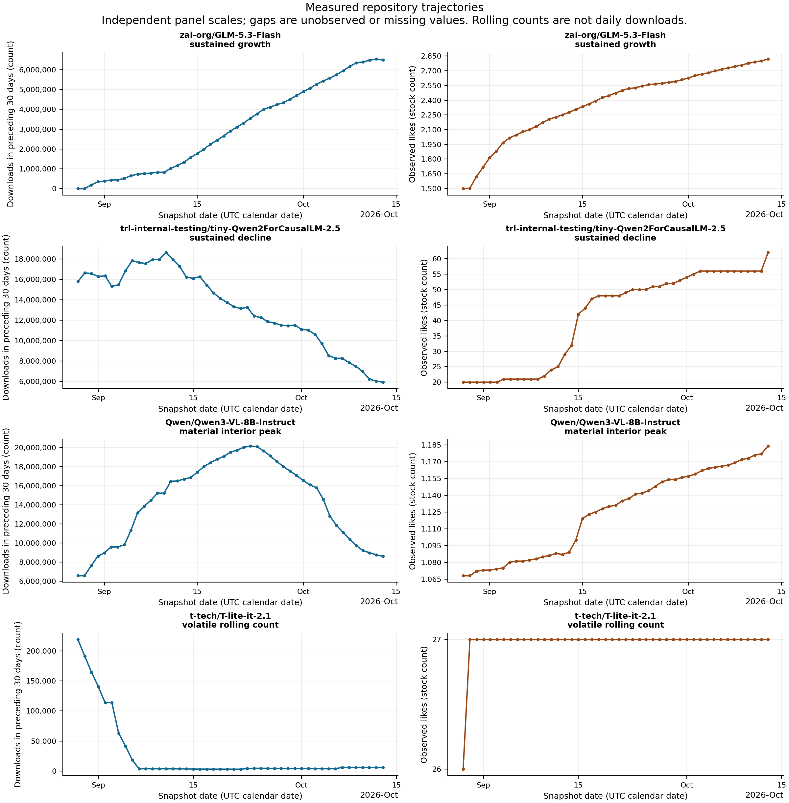

# AI Model Lifecycle: measured growth trajectories

**The history supports distinct measured short-window patterns, but does not yet
establish reliable lifecycle classes.** Growth, decline and interior peaks occur
in the retained repository histories. Their frequency depends strongly on
coverage and screening thresholds; the sample cannot establish population rates.

## Dataset summary

| Measure | Actual value |
|---|---:|
| Collection dates | 2026-08-28–2026-10-13; 47 dates, 46 elapsed days |
| Canonical repository/day observations | 322,661 |
| Exact, case-preserved repository IDs | 32,986 |
| Repositories observed at least twice | 31,062 |
| Repositories observed once | 1,924 |
| Median observation count | 4 |
| Adjacent within-repository intervals | 289,675 |
| Intervals between consecutive calendar dates | 288,160 (99.48%) |
| Baseline qualifying histories | 4,172 (12.65% of sampled repositories) |
| Stricter qualifying histories | 3,286 |
| Null download / like values in retained rows | 0 / 0 |

No calendar date is missing globally, but repository histories have gaps and
sampling exits. Null-free retained rows do not mean absent repositories have
zero downloads. Observations come from the bounded top-5,000 and newest-2,000
text-generation lists plus the smaller OpenRouter-linked detail sample.
Repositories, derivatives and model families are different units.

Existing Silver has 237,930 observations through October 1; Gold shares that
cutoff. The separate research extract matches every overlapping Silver row and
adds 84,731 later observations using the existing parser and precedence. Raw,
Silver and Gold were preserved. See [the audit](results/AUDIT.md) and
[input provenance](input/input_manifest.json).

## Main findings

1. **Follow-up is the principal constraint.** Most sampled repositories have
   short histories: the median is four observations. Only 4,172 satisfy the
   pragmatic baseline screen, and these are selected survivors of bounded sampling.
2. **Different observed arcs are measurable.** Among those 4,172 histories,
   descriptive screens find 253 with predominantly increasing weekly medians and
   material endpoint growth, 400 with the corresponding decline evidence, and
   322 with material rise to an interior maximum followed by an endpoint fall.
   Screens can overlap; these are not mutually exclusive lifecycle classes.
3. **Pattern counts are threshold-sensitive.** Stronger shape thresholds reduce
   those counts to 73, 140 and 35 respectively, using the same 4,172 histories.
   Stronger history requirements instead yield 195, 361 and 269 among 3,286
   histories. The existence of varied arcs is better supported than their prevalence.
4. **Downloads and likes describe different behavior.** 21,446 repositories have
   zero first observed rolling downloads, making baseline percentage growth
   undefined. Likes decline in 61 observed histories. The selected decline case
   loses 62.4% of its rolling download count while likes increase from 20 to 62.

## Concrete cases

All values below are observed **rolling 30-day download counts**, not actual
daily downloads. Cases were selected deterministically by material change,
peak rise/fall or variability, with exact IDs breaking ties. They are interesting
examples rather than typical models drawn at random.

| Repository ID | Observed period | First → last rolling count | Measured feature |
|---|---|---:|---|
| `zai-org/GLM-5.3-Flash` | Aug 28–Oct 13 | 34 → 6,489,462 | Strong sustained increase in weekly medians; huge percentage reflects a tiny baseline |
| `trl-internal-testing/tiny-Qwen2ForCausalLM-2.5` | Aug 29–Oct 13 | 15,788,921 → 5,939,163 | −9,849,758 (−62.4%); internal-testing name does not establish the cause of downloads |
| `Qwen/Qwen3-VL-8B-Instruct` | Aug 28–Oct 13 | 6,560,952 → 8,602,204 | Peaks at 20,173,542 on Sep 23, then falls by 11,571,338 |
| `t-tech/T-lite-it-2.1` | Aug 29–Oct 13 | 218,991 → 5,785 | Large early drop and subsequent smaller movements; −97.4% endpoint change |

[Coverage figure](results/plots/coverage.png), [case table](results/cases.csv),
[case observations](results/case_observations.csv), and
[detailed generated findings and methods](results/REPORT.md).

## Methodological limitations

Baseline qualification requires at least 21 non-null download observations,
28 days of observed span, 80% within-span date coverage and no date spacing above
three days. Stricter qualification requires 42 days, 95% date and download coverage
and daily date spacing. These are research screens, not validated reliability guarantees.
Weekly medians, material-change thresholds, peak rules and their sensitivity are
documented in the generated report. Sparse weekly blocks and nonzero sign
comparisons need cautious interpretation; the latter can cross flat or missing
intervals. Variability of interval changes is descriptive and depends on sampling
spacing; interval rate exports separately use actual elapsed fetch time.

The [official HF API documentation](https://huggingface.co/docs/huggingface_hub/main/package_reference/hf_api#huggingface_hub.ModelInfo)
distinguishes the last-30-day metric from all-time downloads. We observe only the
former. Differences of rolling counts mix entries and expirations from the
window; neither daily downloads nor cumulative downloads can be recovered here.
[Counting rules](https://huggingface.co/docs/hub/models-download-stats) also depend
on file/library formats. Counts do not establish unique users or production adoption.

Forty-seven overlapping rolling-count observations cover about 1.5 windows.
Older repositories are left-censored; disappearance from bounded lists is not
model death. No missing observations are filled or extrapolated. No clustering,
prediction or causal attribution is performed. Releases, promotion, automated
requests and source revisions remain untested possible explanations.

## Engineering assessment and validation

Validation includes nine frozen acceptance tests, source-to-table reconciliation,
cross-platform core reproduction and an automated independent read-only review.
See [validation results](VALIDATION.md) for observed checks, runtime versions
and limits. These checks establish computational consistency; they do not
establish population representativeness, causal validity or predictive reliability.

## Next research directions

- **Early prediction:** early snapshots exist, but most newest repositories lose
  metric follow-up. Future work needs a defined target, explicit missingness and
  censoring policy, and prospectively separated time-based validation. Current
  retrospective qualification must not become an early predictive feature.
- **Persistence/survival:** short observed top-list persistence could be studied
  with censoring. True model survival and long-term persistence require longer
  follow-up and evidence beyond absence from a sampled list.
- **Category patterns:** the text-generation-heavy sampling and small detail leg
  do not support unbiased cross-category comparisons. Establish comparable
  sampling, stable labels and repository/family units first.

These directions were assessed but not implemented. [Reproduction instructions](README.md)
and [independent artifact reconciliation code](validate_artifacts.py) accompany the research.
